# Deployment Documentation (GUI Method)

This repository utilizes **Method B (GUI)** for infrastructure deployment. This document provides a detailed, sequential walkthrough of the provisioning process within the Azure Portal, ensuring a secure, scalable, and cost-optimized environment for the **Startdown.ideas** platform.

## 1. Resource Mapping & Requirements

The following table maps our deployed infrastructure to the core requirements of the project rubric:

| Requirement | Azure Resource Name | Specification |
| :--- | :--- | :--- |
| **1. Resource Group** | `rg-csec3-final-project` | Logical boundary and management container in Japan East. |
| **2. Core Compute** | `startdown-ideas` | App Service & Plan (B1 Tier) scaled to 2 Instances for High Availability. |
| **3. Data Resource** | `startdown-ideas` | Cosmos DB NoSQL (Serverless) for cost-efficiency and JSON flexibility. |
| **4. Security Control** | `kv-startdown-ideas` | Key Vault secured via Managed Identity (Passwordless RBAC). |

## 2. Detailed Provisioning Steps

### Phase 1: Resource Group Foundation
I established a primary Resource Group named `rg-csec3-final-project` to serve as the logical container and security boundary for all project assets. To ensure high availability and bypass regional subscription locks, I provisioned this group in the **Japan East** region. This resource provides a centralized management layer, allowing for unified monitoring, billing, and access control across the entire infrastructure.

#### Provisioning Workflow:
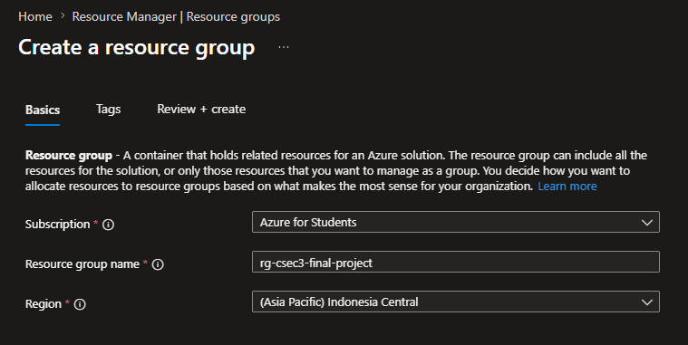
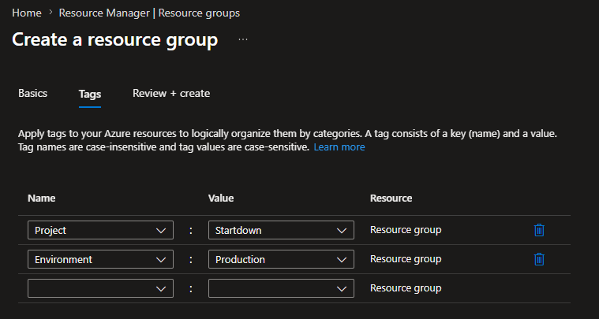
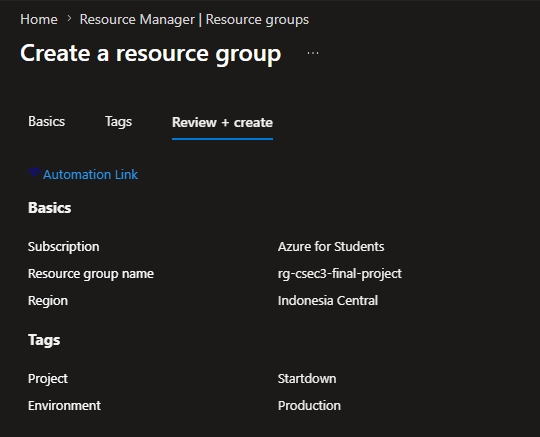
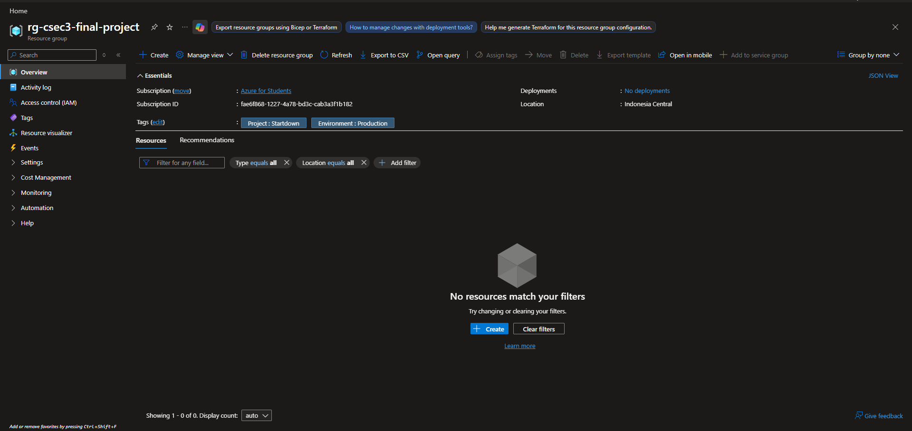

---

### Phase 2: Data Layer (Azure Cosmos DB)
For the application's data layer, I deployed an Azure Cosmos DB account named `startdown-ideas`. I specifically configured this resource in **Serverless capacity mode** to implement a strict Cost Optimization strategy. Unlike traditional provisioned throughput, the serverless model eliminates "idle costs" by charging only for the Request Units (RUs) consumed during active database operations. This architecture ensures the platform can handle the unstructured JSON data from the AI engine while maintaining financial efficiency.

#### Provisioning Workflow:
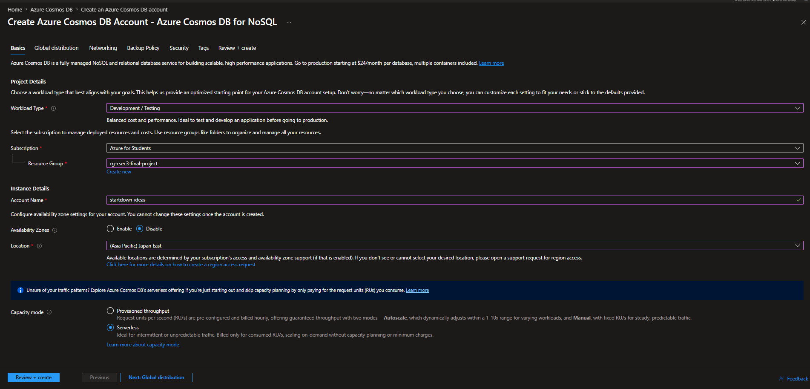
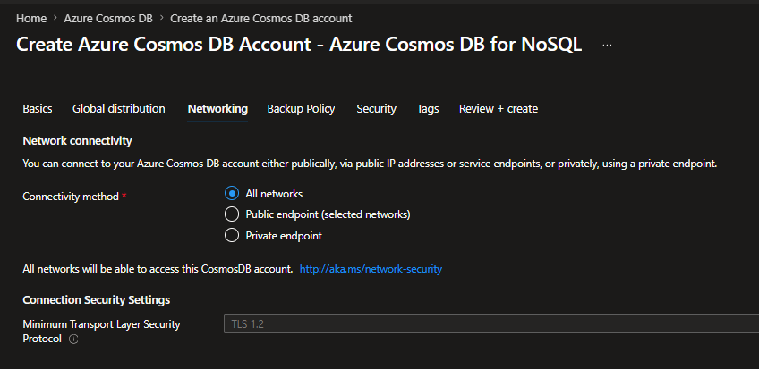
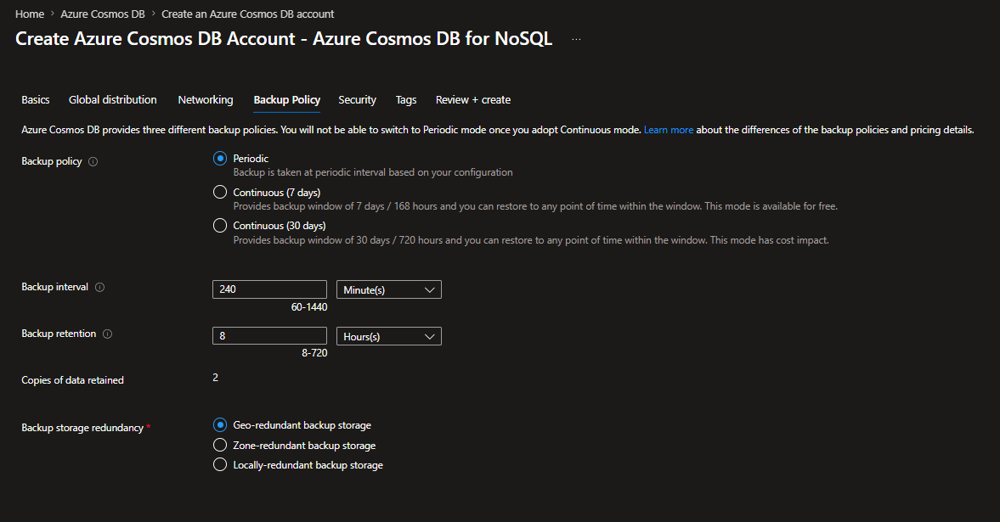
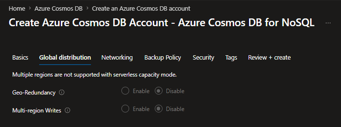
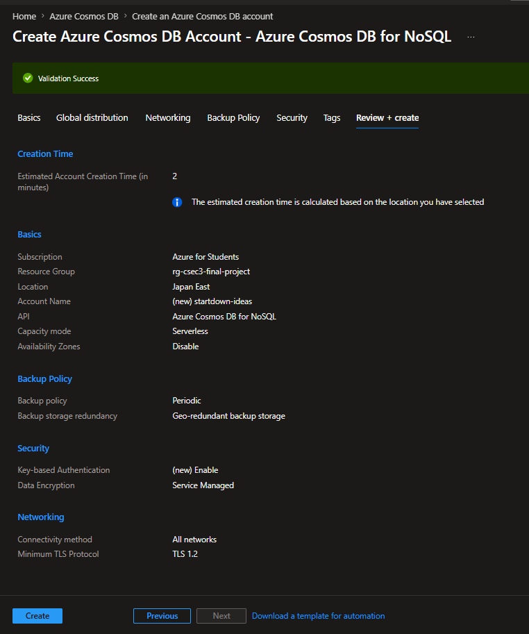
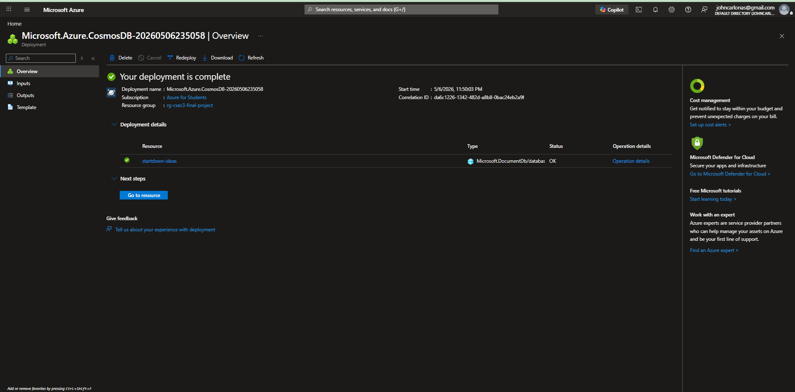

---

### Phase 3: Compute Infrastructure (App Service Plan)
To provide the necessary compute power, I provisioned an Azure App Service Plan named `startdown-ideas` on the **Basic (B1)** tier. This plan was selected specifically to support **Manual Scale-out**, allowing the infrastructure to run on **2 instances**. This multi-instance configuration ensures high availability and horizontal scalability, satisfying the core requirement for a resilient cloud architecture.

#### Provisioning Workflow:
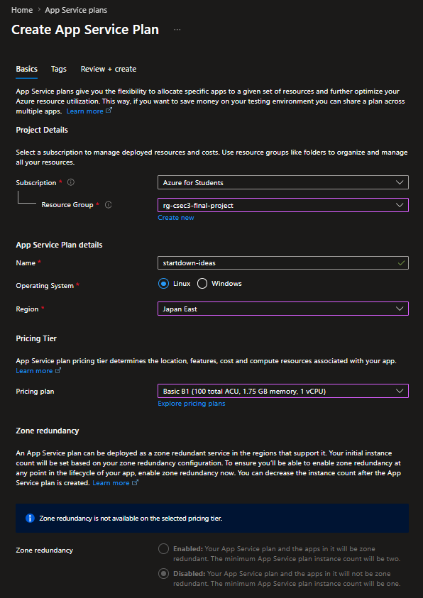
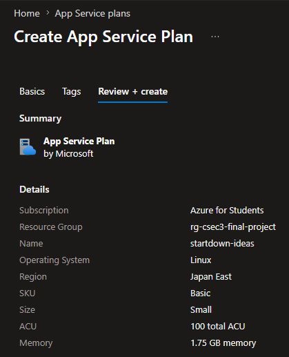
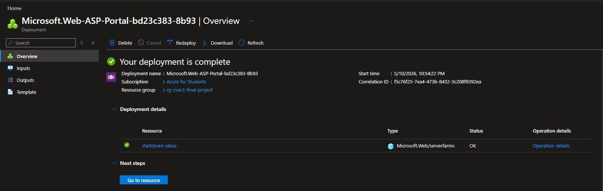

---

### Phase 4: Application Hosting (App Service)
I deployed the Azure App Service named `startdown-ideas` as the primary hosting environment for the project’s Node.js backend and React frontend. This service is tightly integrated with the App Service Plan, benefiting from its scalability. To prepare for production, I configured the App Service with custom Environment Variables to manage connection strings and API keys securely, abstracting the application code from the infrastructure.

#### Provisioning Workflow:
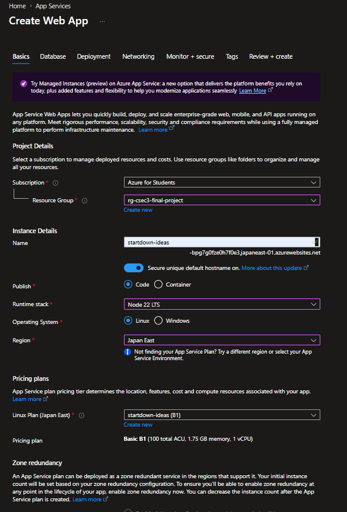
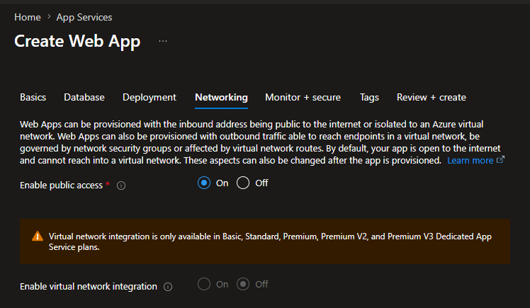
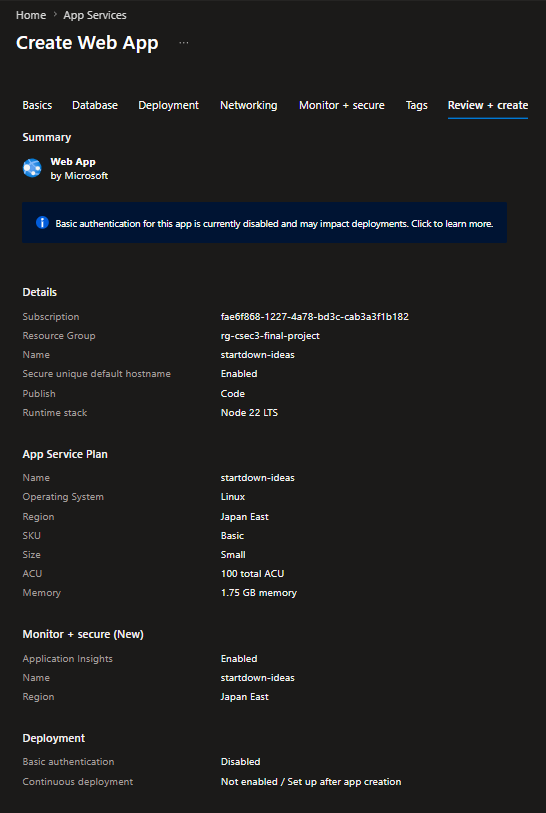
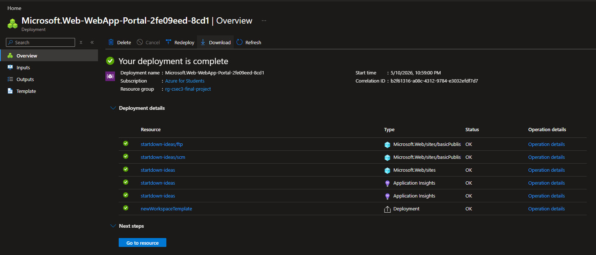

---

### Phase 5: Security Layer (Azure Key Vault)
For sensitive credential management, I implemented Azure Key Vault named `kv-startdown-ideas`. This security control serves as the "Single Source of Truth" for the OpenAI/Groq API keys and Cosmos DB connection strings. By utilizing **Role-Based Access Control (RBAC)**, I ensured that only the authorized **Managed Identity** of the App Service can retrieve secrets. This "Zero Trust" approach eliminates the risk of hard-coding credentials within the source code.

#### Provisioning Workflow:
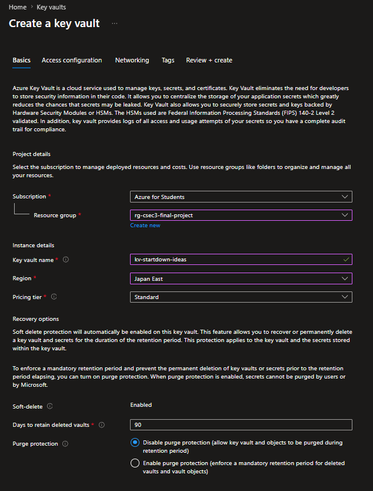
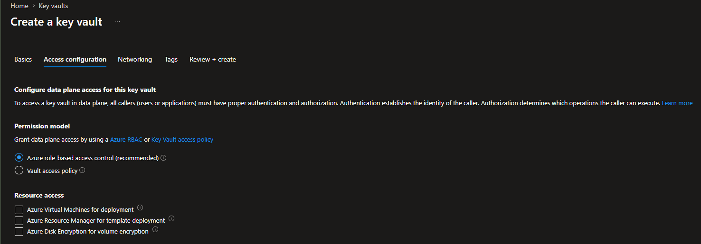
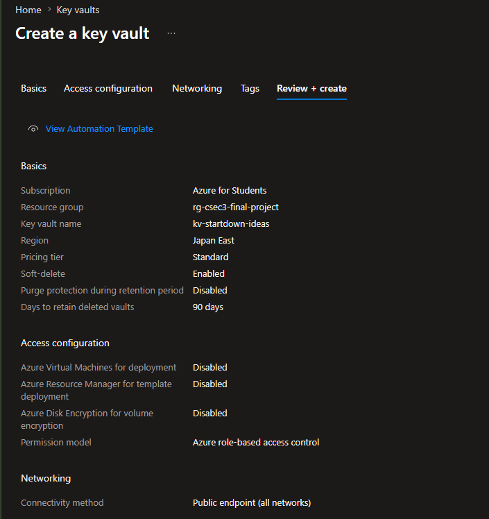
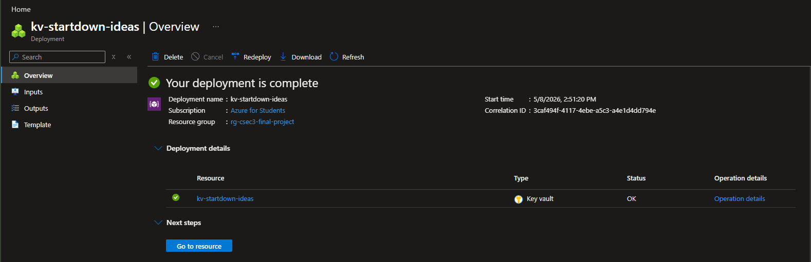

## 3. Scale-Up & Scale-Out Configuration

To fulfill the requirements for High Availability and Fault Tolerance, the following adjustments were performed:

*   **Scale-Up:** Upgraded from Free/Shared to **B1 (Basic)** to unlock Managed Identity and Scaling features.
*   **Scale-Out:** Manually adjusted the instance count to **2**, ensuring traffic is load-balanced across two healthy nodes.
