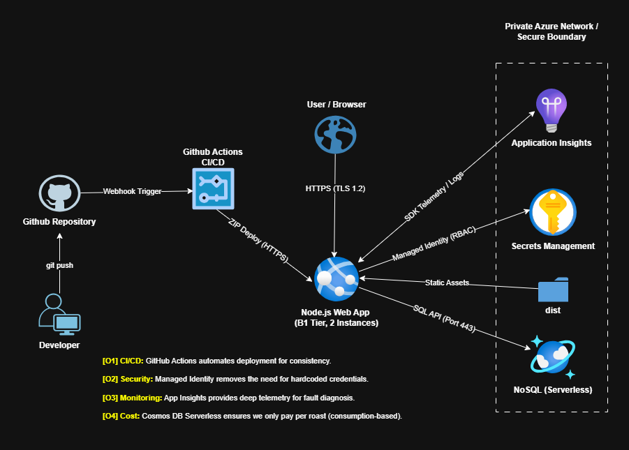

# Architecture Diagram — Startdown.ideas Cloud Infrastructure

## 1. Overview
Startdown.ideas is a cloud-native platform designed to evaluate and "roast" startup concepts using AI. Deployed on Microsoft Azure (Japan East), the architecture focuses on a zero-trust security model, CI/CD automation, and serverless cost efficiency.

## 2. Infrastructure Diagram

*Figure 1: High-level architectural schematic showing the flow from Developer to Production.*

## 3. Logical Zones & Security

### Development & Control Plane (Public)
The "Control Plane" consists of the Developer workstation and GitHub.
- **CI/CD Pipeline**: Code is pushed via SSH to GitHub, triggering a GitHub Actions workflow.
- **Secure Deployment**: The workflow performs a ZIP Deploy over HTTPS directly to the Azure App Service, ensuring that the production environment is never modified manually ("No Manual Changes" policy).

### Production Security Boundary (Private)
A dedicated security boundary isolates internal resources.
- **Managed Identity ([O2])**: The App Service uses a System-Assigned Managed Identity. This allows the app to communicate with Key Vault and Cosmos DB without needing passwords or connection strings stored in the code.
- **Encrypted Traffic**: All internal and external communication is encrypted using TLS 1.2+.

## 4. Core Cloud Services

| Service | Tier / Configuration | Role |
| :--- | :--- | :--- |
| **Azure App Service** | B1 (Basic) | Hosts the Express/Node.js backend and React frontend. Configured with 2 instances for manual scale-out and fault tolerance. |
| **Azure Key Vault** | Standard | Secrets Management. Stores sensitive Groq AI API keys. Access is restricted via RBAC to the App Service's identity. |
| **Cosmos DB** | Serverless (NoSQL) | Data Layer. Stores roast results in the `shame-wall` container. Optimized for cost-to-performance by scaling to zero when idle. |
| **App Insights** | Advanced Telemetry | Observability. Monitors request latency, server-side exceptions, and AI engine response times. |

## 5. Cloud Optimization Highlights (Rubric Requirements)

### [O1] CI/CD Automation (DevOps)
Implemented GitHub Actions to automate the build and deployment process. This ensures that every update to the "Roast Engine" is linted, built, and deployed consistently, reducing human error and deployment downtime.

### [O2] Managed Identity & Key Vault (Security)
Implemented a Zero-Trust approach using Azure Managed Identities. The application retrieves API secrets at runtime from Azure Key Vault. This eliminates "Secret Leakage" risks, as no credentials exist in the GitHub repository or the App Service environment variables.

### [O3] Advanced Telemetry & Monitoring (Operations)
Integrated Azure Application Insights. This provides deep-level telemetry and allows for real-time debugging of performance bottlenecks, such as slow AI inference times or database query latency.

### [O4] Serverless Architecture (Cost Optimization)
Utilized Azure Cosmos DB in Serverless mode. Unlike provisioned throughput, the serverless model only charges for the Request Units (RUs) used during an active roast. This optimization keeps the project within the Azure for Students credit limits while maintaining the ability to handle traffic spikes.

## 6. Connection Matrix

| Source | Destination | Protocol / Auth | Purpose |
| :--- | :--- | :--- | :--- |
| User | App Service | HTTPS (TLS 1.2) | Accessing the UI/API |
| GitHub Actions | App Service | ZIP Deploy (HTTPS) | Automated Code Updates |
| App Service | Key Vault | Managed Identity (RBAC) | Secret Retrieval |
| App Service | Cosmos DB | SQL API (Port 443) | Data Persistence |
| App Service | App Insights | SDK Telemetry | Live Metrics & Logs |
