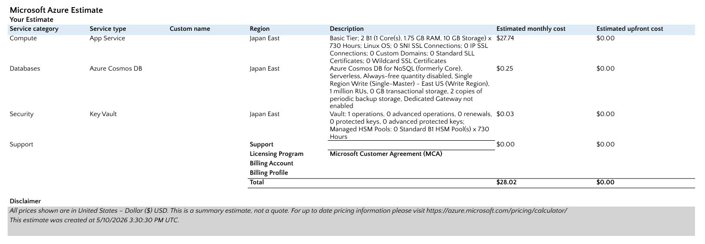

# Cost Estimate Report

## 1. Architecture Summary
The application follows a highly available, secure architecture using a load-balanced App Service, a serverless NoSQL database, and centralized secret management via Key Vault.

## 2. Itemized Monthly Cost Breakdown (Japan East)

| Service | Tier / Configuration | Monthly Cost (Est.) |
| :--- | :--- | :--- |
| **App Service** | Basic (B1), 2 Instances | $27.74 |
| **Cosmos DB** | Serverless Mode (1M RUs) | $0.25 |
| **Key Vault** | Standard (10,000 Ops) | $0.03 |
| **Total** | | **$28.02** |

## 3. Pricing Proof
Below is the detailed breakdown and summary generated via the Azure Pricing Calculator:

### 3.1 Service-Level Estimates

| Service | Screenshot |
| :--- | :--- |
| App Service Estimated Cost | [View Photo](screenshots/as-estimated-cost.png) |
| Cosmos DB Estimated Cost | [View Photo](screenshots/cd-estimated-cost.png) |
| Key Vault Estimated Cost | [View Photo](screenshots/kv-estimated-cost.png) |

### 3.2 Total Monthly Estimate

## 4. Cost Optimization Strategy
To stay within the **Azure for Students** credits, I implemented the following:
* **Serverless Database:** By choosing Cosmos DB Serverless instead of Provisioned Throughput, I reduced the database cost from ~$24/month to **$0.25/month**.
* **B1 Tier Selection:** I  chose the B1 tier as it is the most cost-effective tier that still allows for **Manual Scaling** and **Managed Identities**, which are required for our security and fault-tolerance goals.